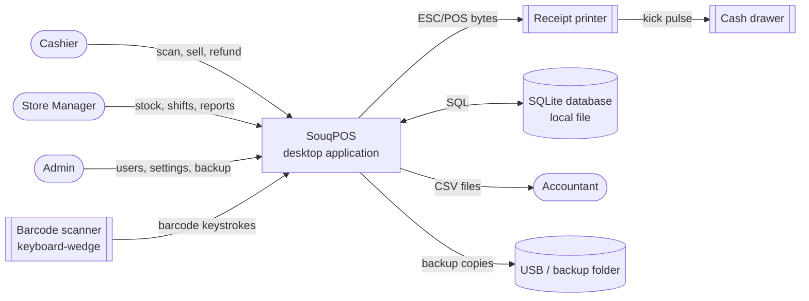
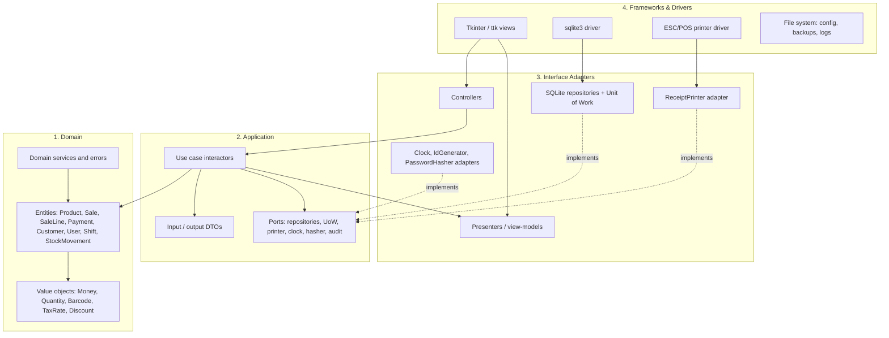

# SouqPOS — Preliminary Design Review (PDR)

Nov 9, 2026 · @Mohamed abughrara

## Executive summary

SouqPOS is an offline-first desktop point-of-sale application for a single small-to-medium retail shop. It is built in Python 3.11 with a Tkinter/ttk GUI and SQLite, and structured on Clean Architecture so the business rules can be tested and maintained without the UI or the database. This PDR asks reviewers to approve the preliminary design so detailed design and construction can start.

**What it does.** Cashiers scan items, apply discounts, take cash, card or split payments, print receipts and process refunds. Managers manage products and stock, open and close shifts with cash reconciliation, and run sales reports. Admins manage users, roles and settings. All 20 functional requirements (FR-01 to FR-20) map to 14 use cases.

**How it is built.** There are four concentric layers: Domain (entities, value objects), Application (use cases, ports), Interface Adapters (presenters, controllers, repository implementations) and Frameworks & Drivers (Tkinter, SQLite, ESC/POS printer). Dependencies point inward only. A single composition root (`main.py`) wires concrete adapters into use cases at startup. Tkinter views follow Model-View-Presenter (MVP) and hold no business logic.

**Key design decisions.**

- Money is stored as integer dirhams (1 LYD = 1,000 dirhams), never as floats (DEC-02).
- Plain `sqlite3` with a thin Unit of Work is preferred over SQLAlchemy to keep the PyInstaller bundle small (DEC-03).
- Sales are immutable once completed; refunds are new, linked records (DEC-05).
- Every privileged action writes an append-only audit log.

**Quality targets.** Scan-to-display under 200 ms, zero data loss on power failure (SQLite WAL), domain and application test coverage of at least 90%, Arabic and English UI with RTL layout.

**Plan and cost.** A 16-week plan across 5 phases, with a team of 3 (1 lead developer, 1 developer, 1 part-time QA/UX). Estimated effort is about 42 person-weeks.

**Top risks.** Tkinter's limited RTL support, printer driver variety, and scope creep into multi-terminal sync. Each has a mitigation in section 15.

**Decision requested.** Approve the architecture, data model and plan, and close open issues OI-01 to OI-05 before the Critical Design Review (CDR).

## 1. Document control

| Field | Value |
| --- | --- |
| Document | SouqPOS Preliminary Design Review (PDR) |
| Document ID | SPOS-PDR-001 |
| Version | 0.9 (draft for review) |
| Classification | Internal |
| Author | Mohamed Abughrara, Project Manager |
| Status | Draft for review |

**Approvals**

| Role | Name | Decision | Date | Signature |
| --- | --- | --- | --- | --- |
| Project sponsor | TBD |  |  |  |
| Lead architect | TBD |  |  |  |
| QA lead | TBD |  |  |  |
| Store operations representative | TBD |  |  |  |

**Revision history**

| Version | Date | Author | Change |
| --- | --- | --- | --- |
| 0.9 | 2026-11-09 | M. Abughrara | Full draft for PDR board |
| 0.1 | 2026-11-02 | M. Abughrara | Outline and scope |

## 2. Introduction

### 2.1 Purpose

This document presents the preliminary design of SouqPOS for formal review. It shows that the architecture meets the requirements, that risks are known and handled, and that the project is ready for detailed design.

### 2.2 Scope

In scope for release 1.0:

- Checkout: scanning, cart, discounts, taxes, cash/card/split payment, receipts
- Refunds and returns against an original sale
- Product catalogue, inventory, stock movements and low-stock alerts
- Customer records (basic loyalty identifier)
- Shifts with opening float and closing cash reconciliation
- Reports: daily sales, sales by product, by cashier, by payment method
- Users, roles, login and audit log

Out of scope for 1.0: multi-store, multi-terminal sync, online ordering, card terminal integration (card payments are recorded manually), accounting export beyond CSV, mobile clients.

### 2.3 Definitions and acronyms

| Term | Meaning |
| --- | --- |
| PDR | Preliminary Design Review |
| CDR | Critical Design Review |
| POS | Point of Sale |
| SKU | Stock Keeping Unit |
| DTO | Data Transfer Object: a plain data carrier across a layer boundary |
| Port | An abstract interface owned by the application layer |
| Adapter | A concrete implementation of a port (e.g., SQLite repository) |
| MVP | Model-View-Presenter UI pattern |
| UoW | Unit of Work: groups repository writes into one transaction |
| WAL | SQLite Write-Ahead Logging mode |
| ESC/POS | Epson command language used by most thermal receipt printers |
| LYD | Libyan dinar; 1 LYD = 1,000 dirhams |
| RTL | Right-to-left text layout (Arabic) |
| Float | Cash placed in the drawer at the start of a shift |

### 2.4 References

1. Robert C. Martin, *Clean Architecture: A Craftsman's Guide to Software Structure and Design*, Prentice Hall, 2017
2. Python 3.11 documentation: `tkinter`, `sqlite3`, `dataclasses`, `typing.Protocol`
3. SQLite documentation: Write-Ahead Logging, `PRAGMA user_version`
4. Epson ESC/POS command reference
5. OWASP Password Storage Cheat Sheet

### 2.5 Assumptions

| ID | Assumption |
| --- | --- |
| A-01 | The product name "SouqPOS" is a working name. |
| A-02 | Currency is LYD, stored as integer dirhams. |
| A-03 | Tax is configurable per product category with a default rate of 0%, since rules vary; the shop can set rates in Settings. |
| A-04 | UI languages are Arabic (RTL) and English (LTR), switchable per user. |
| A-05 | Team: 1 lead developer, 1 developer, 1 part-time QA/UX; 16 calendar weeks. |
| A-06 | Hardware: one PC per till, USB keyboard-wedge scanner, USB/network ESC/POS printer, printer-kicked cash drawer. |
| A-07 | Catalogue size up to 20,000 SKUs and up to 1,500 sales per day. |
| A-08 | Card payments are taken on a standalone terminal and recorded in SouqPOS with a reference number. |

## 3. System overview

SouqPOS runs entirely on the till PC and keeps working with no network. External parties touch it only through hardware or file exports.

### 3.1 Goals

| ID | Goal | Measure |
| --- | --- | --- |
| G-01 | Fast, error-free checkout | Average basket of 10 items checked out in under 60 s |
| G-02 | Accurate cash and stock | Shift variance reported to the dirham; stock matches movements 100% |
| G-03 | Works offline | All functions available with no network |
| G-04 | Maintainable and testable | Business rules testable with no UI or DB; ≥ 90% coverage |
| G-05 | Bilingual | Full Arabic (RTL) and English UI |

### 3.2 Stakeholders

| Stakeholder | Interest |
| --- | --- |
| Cashier | Speed, simple screens, keyboard shortcuts, clear errors |
| Store manager | Stock control, refunds approval, shift reconciliation, reports |
| Admin / owner | Users and roles, prices, tax settings, backups, audit |
| Customer | Correct prices, printed receipt, quick refunds |
| Development team | Clear boundaries, testability, simple packaging |
| Accountant (external) | CSV exports of sales and taxes |

### 3.3 Context diagram

## 4. Requirements summary

Priority uses MoSCoW: M = Must, S = Should, C = Could.

### 4.1 Functional requirements

| ID | Requirement | Priority | Role |
| --- | --- | --- | --- |
| FR-01 | The system shall add an item to the cart by barcode scan or manual SKU/name search. | M | Cashier |
| FR-02 | The system shall show cart lines with quantity, unit price, line discount, tax and total, and update totals on every change. | M | Cashier |
| FR-03 | The system shall allow changing quantity, removing a line and voiding the whole cart before payment. | M | Cashier |
| FR-04 | The system shall apply line and cart discounts (percent or fixed); discounts above a configured limit need manager approval. | M | Cashier, Manager |
| FR-05 | The system shall calculate tax per product category using configured rates (inclusive or exclusive). | M | System |
| FR-06 | The system shall accept cash, card and split payments, compute change and block completion until fully paid. | M | Cashier |
| FR-07 | The system shall print a receipt on completion, open the cash drawer for cash payments and support reprint. | M | Cashier |
| FR-08 | The system shall park and recall a sale. | S | Cashier |
| FR-09 | The system shall process full or partial refunds against an original receipt, with manager approval, restocking returned items. | M | Cashier, Manager |
| FR-10 | The system shall create, edit and deactivate products with barcode, SKU, name (AR/EN), category, price, cost and tax category. | M | Manager |
| FR-11 | The system shall record stock movements (sale, refund, receipt, adjustment, waste) and keep on-hand quantity. | M | System, Manager |
| FR-12 | The system shall alert when on-hand stock falls at or below a product's reorder level. | S | Manager |
| FR-13 | The system shall store customer records (name, phone, optional loyalty ID) and attach a customer to a sale. | S | Cashier |
| FR-14 | The system shall require an open shift with an opening float before any sale. | M | Cashier |
| FR-15 | The system shall close a shift with counted cash, expected cash and variance, and print a Z-report. | M | Cashier, Manager |
| FR-16 | The system shall produce reports: daily sales, by product, by cashier, by payment method, tax summary; export to CSV. | M | Manager |
| FR-17 | The system shall authenticate users by username and password or PIN. | M | All |
| FR-18 | The system shall enforce role-based permissions (Cashier, Manager, Admin). | M | Admin |
| FR-19 | The system shall let Admins manage users, store details, tax rates, receipt header/footer and printer settings. | M | Admin |
| FR-20 | The system shall back up the database on demand and on a schedule, and restore from a backup. | M | Admin |

### 4.2 Non-functional requirements

| ID | Category | Requirement | Verification |
| --- | --- | --- | --- |
| NFR-01 | Performance | Scan-to-display ≤ 200 ms (95th percentile) with 20,000 SKUs. | Benchmark test |
| NFR-02 | Performance | Sale completion (save + print command) ≤ 1 s. | Benchmark test |
| NFR-03 | Performance | Daily report for 1,500 sales renders in ≤ 3 s. | Benchmark test |
| NFR-04 | Reliability | No committed sale is lost on power failure; SQLite WAL + atomic transactions. | Kill-process test |
| NFR-05 | Reliability | Printer failure never blocks or rolls back a sale; receipt is queued for reprint. | Integration test |
| NFR-06 | Availability | 100% of functions available offline. | System test with network disabled |
| NFR-07 | Usability | A new cashier completes a sale after ≤ 15 minutes of training; every checkout action has a keyboard shortcut. | Usability test |
| NFR-08 | Security | Passwords hashed with a salted, slow algorithm (PBKDF2-SHA256, ≥ 600,000 iterations). | Code review, unit test |
| NFR-09 | Security | Session auto-locks after 5 minutes idle (configurable). | System test |
| NFR-10 | Auditability | All privileged actions (refund, void, price change, discount override, stock adjustment, login) are written to an append-only audit log. | Integration test |
| NFR-11 | Maintainability | Domain and application layers import nothing from `tkinter`, `sqlite3` or any infrastructure package. | Automated import-linter rule in CI |
| NFR-12 | Testability | Domain + application line coverage ≥ 90%; overall ≥ 75%. | pytest-cov in CI |
| NFR-13 | Localization | All UI strings externalized; Arabic RTL layout; Arabic-Indic digits optional; receipts printable in Arabic. | Review + system test |
| NFR-14 | Portability | Runs on Windows 10/11 and Ubuntu 22.04+ from a single codebase. | Test matrix |
| NFR-15 | Accuracy | All money arithmetic uses integer dirhams; rounding rule half-up at line level, documented. | Unit tests |
| NFR-16 | Installability | Installer ≤ 60 MB; install in ≤ 5 minutes without admin knowledge. | Release checklist |

## 5. Architecture design (Clean Architecture)

The system has four layers, and source-code dependencies point only inward: Frameworks → Adapters → Application → Domain. The application layer owns the interfaces (ports) that outer layers implement, so SQLite, Tkinter and the printer can be replaced without touching a business rule.

### 5.1 Layer diagram

The rule is enforced in CI by `import-linter` contracts: `pos.domain` may import only the standard library; `pos.application` may import only `pos.domain`; `pos.adapters` may import `pos.application` and `pos.domain`; only `pos.infrastructure`, `pos.ui_tkinter` and `main.py` may import `tkinter` or `sqlite3`.

### 5.2 Domain layer: entities

| Entity | Key attributes | Invariants and behaviour |
| --- | --- | --- |
| Product | id, sku, barcode, name\_ar, name\_en, category\_id, price: Money, cost: Money, tax\_category, reorder\_level, is\_active | Price ≥ 0; barcode unique; inactive products cannot be sold. |
| Sale (aggregate root) | id, number, shift\_id, cashier\_id, customer\_id?, lines, cart\_discount, payments, status, created\_at | Status flow DRAFT → PARKED ⇄ DRAFT → COMPLETED or VOIDED. Lines and payments change only while DRAFT. `complete()` requires paid ≥ total. Completed sales are immutable. |
| SaleLine | product\_id, name snapshot, unit\_price, quantity, line\_discount, tax\_rate | Quantity > 0; discount ≤ line gross. Price and tax are snapshotted at scan time. |
| Payment | method (CASH, CARD), amount: Money, tendered?, reference? | Amount > 0; card requires reference; change only on cash. |
| Refund (aggregate root) | id, original\_sale\_id, lines, method, approved\_by, reason | Refunded qty per line ≤ sold qty minus earlier refunds. |
| Customer | id, name, phone, loyalty\_id? | Phone unique when present. |
| User | id, username, display\_name, role, password\_hash, pin\_hash?, is\_active, locale | Username unique; inactive users cannot log in. |
| Shift | id, cashier\_id, opened\_at, opening\_float, closed\_at?, counted\_cash?, expected\_cash?, status | One OPEN shift per till. Variance = counted − expected. Closed shifts are immutable. |
| StockMovement | id, product\_id, type (SALE, REFUND, RECEIPT, ADJUSTMENT, WASTE), qty\_delta, ref\_id, user\_id, at | Append-only; on-hand = sum of qty\_delta. |
| AuditEntry | id, at, user\_id, action, entity, entity\_id, details\_json | Append-only. |

### 5.3 Domain layer: value objects

| Value object | Representation | Rules |
| --- | --- | --- |
| Money | `amount: int` in dirhams, `currency: str = "LYD"` | Immutable; add/subtract only same currency; `allocate()` for splits; formatting lives in adapters, not here. |
| Quantity | `value: Decimal`, `unit` (PIECE, KG) | Pieces must be whole; KG to 3 decimals; > 0 for sale lines. |
| Barcode | `value: str` | EAN-13, EAN-8, UPC-A checksum validated; internal codes allowed with prefix `2`. |
| TaxRate | `basis_points: int` (e.g., 500 = 5%), `inclusive: bool` | 0 ≤ bp ≤ 10,000. |
| Discount | kind (PERCENT, FIXED), value | Percent 0–100; fixed ≤ target amount. |

Domain errors are typed exceptions derived from `DomainError`: `ProductInactive`, `InsufficientPayment`, `SaleNotEditable`, `RefundExceedsSold`, `ShiftNotOpen`, `ShiftAlreadyOpen`, `DiscountLimitExceeded`.

### 5.4 Application layer: use cases

| ID | Use case | Actor | FRs |
| --- | --- | --- | --- |
| UC-01 | Login / Lock / Unlock | All | FR-17, FR-18 |
| UC-02 | OpenShift | Cashier | FR-14 |
| UC-03 | ScanItem | Cashier | FR-01, FR-02, FR-05 |
| UC-04 | EditCart (change qty, remove line, void cart) | Cashier | FR-03 |
| UC-05 | ApplyDiscount | Cashier, Manager | FR-04 |
| UC-06 | CompleteSale | Cashier | FR-06, FR-07, FR-11 |
| UC-07 | ParkSale / RecallSale | Cashier | FR-08 |
| UC-08 | ReprintReceipt | Cashier | FR-07 |
| UC-09 | ProcessRefund | Cashier + Manager | FR-09, FR-11 |
| UC-10 | ManageCatalogue (products, categories, customers) | Manager | FR-10, FR-13 |
| UC-11 | AdjustStock (receipt, adjustment, waste) | Manager | FR-11, FR-12 |
| UC-12 | CloseShift | Cashier, Manager | FR-15 |
| UC-13 | GenerateReport / ExportCsv | Manager | FR-16 |
| UC-14 | Administer (users, settings, backup/restore) | Admin | FR-18, FR-19, FR-20 |

The eight core use cases are specified below. All return an output DTO or raise a typed error; none touch UI or SQL directly.

**UC-03 ScanItem**

- Input: `ScanItemInput(sale_id: str | None, code: str, quantity: Decimal = 1)`
- Output: `CartView(sale_id, lines: list[CartLineView], subtotal, discount_total, tax_total, total)`
- Steps: 1) require open shift; 2) load or create DRAFT sale; 3) look up product by barcode, then SKU; 4) `sale.add_item(product, qty)` merges with an existing line of the same product; 5) save via UoW; 6) return cart view.
- Errors: `ShiftNotOpen`, `ProductNotFound`, `ProductInactive`, `InvalidQuantity`, `SaleNotEditable`.

**UC-05 ApplyDiscount**

- Input: `ApplyDiscountInput(sale_id, target: LINE | CART, line_no?, kind, value, approver_credentials?)`
- Output: `CartView`
- Steps: 1) load DRAFT sale; 2) build `Discount`; 3) if above the user's role limit, verify approver is Manager+ via `PasswordHasher`; 4) apply; 5) audit `DISCOUNT_APPLIED` (with approver); 6) save.
- Errors: `DiscountLimitExceeded`, `ApprovalRejected`, `InvalidDiscount`, `SaleNotEditable`.

**UC-06 CompleteSale**

- Input: `CompleteSaleInput(sale_id, payments: list[PaymentInput(method, amount, tendered?, reference?)], customer_id?)`
- Output: `SaleReceipt(sale_id, number, lines, totals, payments, change_due, printed: bool)`
- Steps: 1) load DRAFT sale; 2) add payments; 3) `sale.complete(clock.now())` validates paid ≥ total; 4) in one UoW transaction save sale, write one SALE `StockMovement` per line, assign sequential receipt number; 5) commit; 6) after commit, call `ReceiptPrinter.print()` and `open_drawer()` if any cash; a printer error sets `printed=False` and queues the receipt, never rolls back.
- Errors: `InsufficientPayment`, `CardReferenceMissing`, `SaleNotEditable`, `ShiftNotOpen`.

**UC-09 ProcessRefund**

- Input: `RefundInput(original_receipt_no, lines: list[(line_no, qty)], method, reason, approver_credentials)`
- Output: `RefundReceipt(refund_id, original_no, lines, amount, method, printed)`
- Steps: 1) load completed original sale; 2) verify approver role ≥ Manager; 3) build `Refund` with per-line limits; 4) in one transaction save refund, write REFUND stock movements, audit `REFUND`; 5) print refund slip; open drawer if cash.
- Errors: `SaleNotFound`, `SaleNotRefundable`, `RefundExceedsSold`, `ApprovalRejected`, `ShiftNotOpen`.

**UC-02 OpenShift**

- Input: `OpenShiftInput(cashier_id, opening_float: int)`
- Output: `ShiftView(shift_id, opened_at, opening_float)`
- Steps: 1) ensure no OPEN shift on this till; 2) create shift; 3) audit; 4) open drawer.
- Errors: `ShiftAlreadyOpen`, `InvalidAmount`.

**UC-12 CloseShift**

- Input: `CloseShiftInput(shift_id, counted_cash: int, denominations?: dict[int,int], approver_credentials?)`
- Output: `ZReport(shift_id, sales_count, gross, discounts, tax, refunds, net, by_method, expected_cash, counted_cash, variance)`
- Steps: 1) block if parked sales exist (or force-void with manager approval); 2) expected cash = float + cash sales − cash refunds − change; 3) close shift; 4) if |variance| > threshold require manager approval; 5) audit; 6) print Z-report.
- Errors: `ShiftNotOpen`, `ParkedSalesExist`, `ApprovalRequired`.

**UC-11 AdjustStock**

- Input: `AdjustStockInput(product_id, type: RECEIPT | ADJUSTMENT | WASTE, qty_delta, reason)`
- Output: `StockLevelView(product_id, on_hand, below_reorder: bool)`
- Steps: 1) check permission; 2) write movement; 3) audit; 4) recompute on-hand; 5) flag low stock.
- Errors: `PermissionDenied`, `ProductNotFound`, `InvalidQuantity`.

**UC-13 GenerateDailyReport**

- Input: `ReportInput(kind, date_from, date_to, cashier_id?)`
- Output: `ReportView(title, columns, rows, totals)`; `ExportCsv` writes the same view to a file.
- Steps: 1) check permission; 2) query read-model via `ReportQueries` port; 3) map to view.
- Errors: `PermissionDenied`, `InvalidDateRange`.

### 5.5 Interface adapters

**Ports (owned by `pos.application.ports`)**

| Port | Responsibility |
| --- | --- |
| `ProductRepository` | get\_by\_barcode, get\_by\_sku, search, save |
| `SaleRepository` | get, save, next\_number, list\_parked, find\_by\_number |
| `RefundRepository`, `ShiftRepository`, `CustomerRepository`, `UserRepository` | CRUD for their aggregates |
| `StockLedger` | append movement, on\_hand(product\_id) |
| `AuditLog` | append(entry) |
| `UnitOfWork` | context manager: exposes repositories, `commit()`, `rollback()` |
| `ReportQueries` | read-only, SQL-optimised queries returning plain rows |
| `ReceiptPrinter` | print(receipt\_dto), open\_drawer() |
| `PasswordHasher` | hash(secret), verify(secret, hash) |
| `Clock`, `IdGenerator` | now(), new\_id(); faked in tests |

**Controllers** translate widget events into input DTOs and call a use case. **Presenters** turn output DTOs and errors into view-models: formatted strings (`"12.500 د.ل"`), localized labels, enable/disable flags. Views only render view-models.

### 5.6 Frameworks and drivers

- `ui_tkinter`: `ttk` frames per screen, theme, RTL helper, keyboard bindings, scanner input capture.
- `infrastructure/sqlite`: connection factory (WAL, `foreign_keys=ON`, `synchronous=NORMAL`), migrations, repository implementations.
- `infrastructure/printing`: ESC/POS adapter (`python-escpos`) with USB, network and file/PDF back-ends; a `NullPrinter` for tests.
- `infrastructure/security`: PBKDF2 hasher from `hashlib`.
- `infrastructure/config`: TOML settings loader (`tomllib`).

### 5.7 Dependency injection and composition root

There is no DI framework. `main.py` is the only place that knows every concrete class. It: 1) loads config; 2) configures logging; 3) opens the SQLite connection and runs pending migrations; 4) builds adapters (UoW factory, printer, hasher, clock); 5) builds each use case with its ports; 6) builds presenters and controllers; 7) builds the Tkinter root and screen router; 8) starts `mainloop()`. Tests build the same graph with in-memory fakes.
